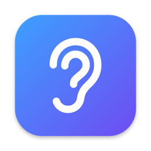
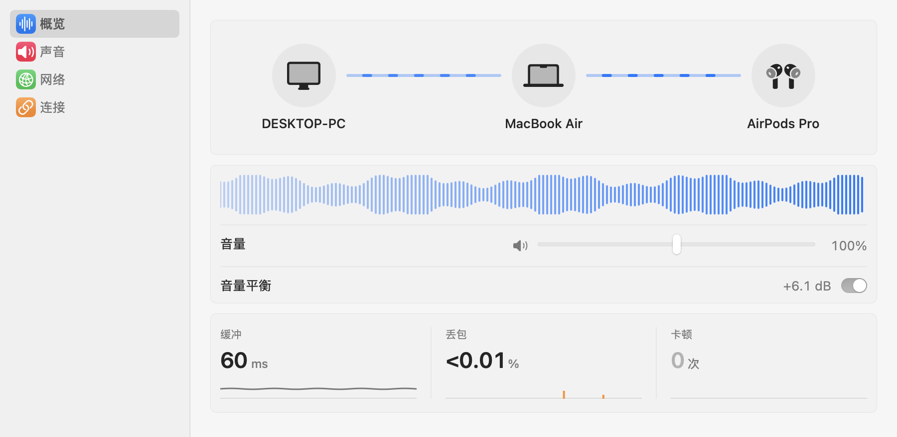
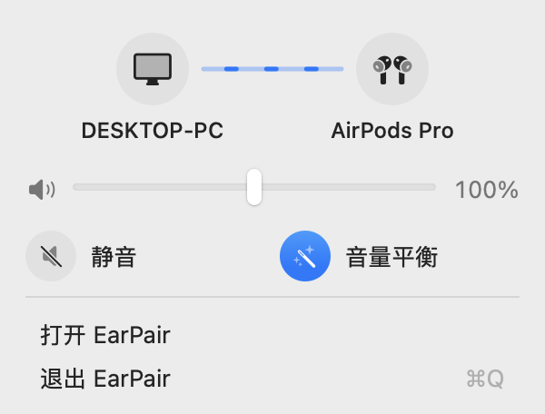
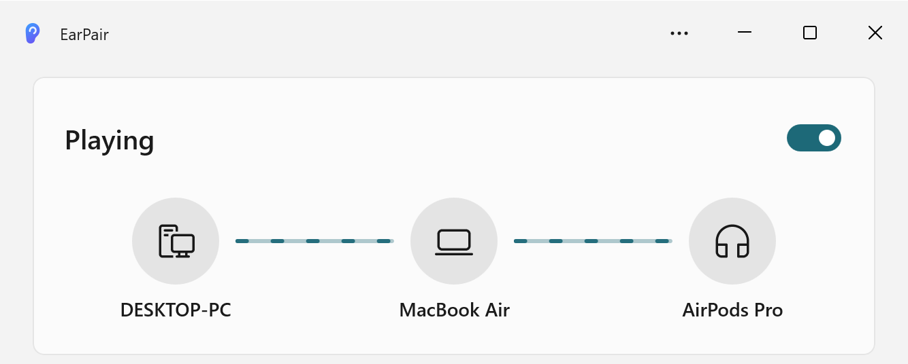

  

<h1 align="center">EarPair</h1>

Hear your Windows PC through the AirPods on your Mac.

<b>English</b> | <a href="README.zh-CN.md">简体中文</a>

  <picture>
    <source media="(prefers-color-scheme: dark)" srcset="docs/images/mac-window-dark.png">
    
  </picture>

Your AirPods stay connected to your Mac. EarPair sends your Windows PC's sound over your local network, and the Mac plays it together with its own audio. No Bluetooth switching, no extra cables, and your audio never leaves your network: no account, no cloud, no telemetry.

## Features

- **Both computers in one pair of headphones.** The PC plays alongside the Mac, through whatever the Mac is using: AirPods, speakers or headphones.
- **Finds your Mac by itself.** The Windows app lists the Macs on your network. Click one to start, no IP address needed.
- **Even loudness.** Auto-leveling keeps quiet and loud PC audio at a steady volume.
- **A quiet PC.** Mutes the PC's own speakers while sending and turns them back on when you stop.
- **Rides out Wi‑Fi hiccups.** Lost or late packets and clock drift between the two machines don't cause clicks or a growing delay.
- **Idle when the PC is quiet.** After a few seconds of silence the PC stops streaming and only keeps a light handshake with the Mac, saving battery and Wi‑Fi. Sound picks up again the moment something plays.
- **Tells a stop from a dropout.** The Mac shows a notification when a PC connects or stops sending. If the network drops instead, the notification says so and EarPair reconnects by itself.
- **Spatial audio with AirPods.** Show EarPair once where the Mac and the PC are. The PC's sound then comes from the PC's screen and the Mac's from the Mac's, and both stay put as you turn your head; the one you look away from moves aside and gets quieter. It pauses while the PC isn't sending and picks up again when it's back.
- **Stays out of the way.** It lives in the Mac's menu bar and in the Windows notification area, and can start with Windows.
- **Nothing to install on Windows.** Unzip and run; the .NET runtime is included.

  <picture>
    <source media="(prefers-color-scheme: dark)" srcset="docs/images/mac-menu-dark.png">
    
  </picture>
  &nbsp;&nbsp;
  <picture>
    <source media="(prefers-color-scheme: dark)" srcset="docs/images/windows-card-dark.png">
    
  </picture>

## Requirements

- **Mac:** macOS 14 or later (Liquid Glass on macOS 26 and later)
- **PC:** Windows 10 (version 2004) or Windows 11, x64 or Arm64
- Both on the same local network

Both apps are in English and Simplified Chinese, following the system language.

## Getting started

1. **On the Mac,** download `EarPair-0.2.1-macos-universal.dmg` from [Releases](https://github.com/milkman-wang/EarPair/releases/latest), open it, drag EarPair to Applications and open it from there.

   EarPair's window opens and an ear appears in the menu bar; closing the window keeps EarPair running there. When macOS asks whether EarPair may find devices on your local network, click **Allow**: that's how the PC finds the Mac. Allow notifications as well, so you know when a PC connects or drops off.

2. **On the PC,** download `EarPair-0.2.1-win-x64-setup.exe` (`win-arm64` for Arm PCs) from [Releases](https://github.com/milkman-wang/EarPair/releases/latest) and run it. EarPair opens when setup finishes.

3. **Click your Mac** in the list. The PC's sound now plays on the Mac, and the PC's speakers stay quiet until you stop.

Closing the window keeps EarPair running in the notification area (Windows 11 may tuck the icon under **^**). Turn on **Start at login** to have it ready after a restart.

> [!NOTE]
> EarPair isn't code-signed yet. The first time you run setup, Windows may show **Windows protected your PC**: click **More info → Run anyway**. On the Mac, if macOS says it can't verify EarPair, open **System Settings → Privacy & Security** and click **Open Anyway**. Each new version of the Mac app asks for local network access again.

## Good to know

- **Every app on the PC is captured** (EarPair itself excepted), whichever speakers it plays to. To send just one output device instead, pick it under **Sound source**. Per-app capture is planned.
- **Use it on networks you trust.** Audio isn't encrypted yet, and anything on the network can send to your Mac.
- **The PC stays awake while sending.** Sending pauses by itself when the Mac goes away and resumes when it's back.
- **Set the volume on the Mac.** The PC's own volume doesn't change what you hear, and the Windows volume keys unmute the PC's speakers; switch sending off and on to mute them again.
- **To remove EarPair from the PC,** uninstall it in Windows **Settings → Apps**.

## Troubleshooting

| Problem | What to do |
|---|---|
| The PC doesn't list your Mac | Use the same network on both (not a guest network that keeps devices apart), set the Windows network profile to **Private network**, and turn off any VPN. On the Mac, check **System Settings → Privacy & Security → Local Network**. You can also click **Enter address** and type the Mac's IP, shown in the Mac's menu bar panel. |
| No ear in the Mac's menu bar | On macOS 26 and later, open **System Settings → Menu Bar** and turn on EarPair under **Allow in the Menu Bar**. |
| No notifications on the Mac | Open **System Settings → Notifications → EarPair** and turn on **Allow Notifications**. |
| It stopped working after updating the Mac app | Allow local network access for EarPair again, as above. |
| The PC's speakers are playing again | The Windows volume keys unmuted them. Switch sending off and on. |
| Something else | On Windows, open **⋯ → Open log folder** and look at the latest log. |

## How it works

The Windows app captures what the PC is playing and streams it to the Mac as uncompressed audio over UDP. It takes each app's sound before it reaches the speakers (Windows process loopback), so muting the PC or turning its volume down doesn't change what the Mac gets — on some sound cards, capturing the speakers' output instead goes silent as soon as they're muted. On older Windows 10, or when you pick a specific output device, it captures that device's output. The Mac keeps a short buffer, smooths over lost packets and the clock difference between the two machines, and plays the stream like any other app, so macOS mixes it with everything else. The two apps also swap names and status, which is how both can draw the whole route. Packet formats: [audio](protocol/audio-packet.md), [control](protocol/control-packet.md).

## Building from source

- **Mac:** `macos/scripts/build-app.sh` with Xcode 26 or later.
- **Windows:** `powershell -ExecutionPolicy Bypass -File windows\build.ps1` with the [.NET 10 SDK](https://dotnet.microsoft.com/download/dotnet/10.0). No Visual Studio needed. The installers land in `dist\` (with [Inno Setup 6](https://jrsoftware.org/isinfo.php); zips without it).

Tests, tools and the project layout are in [docs/development.md](docs/development.md).

## Roadmap

- Choose which PC apps to send
- Pairing, encryption and signed builds
- Spatial audio that places the PC's sound toward its screen
