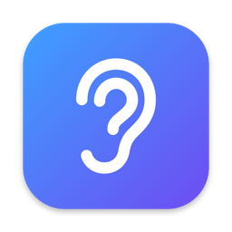
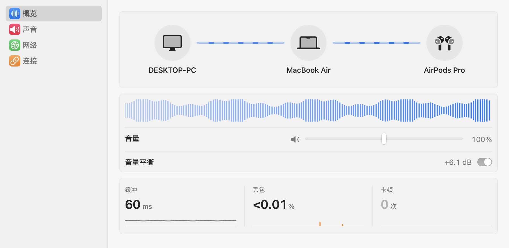
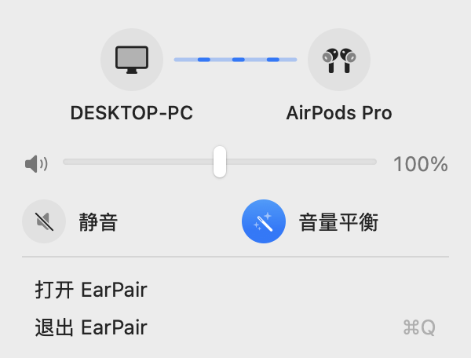
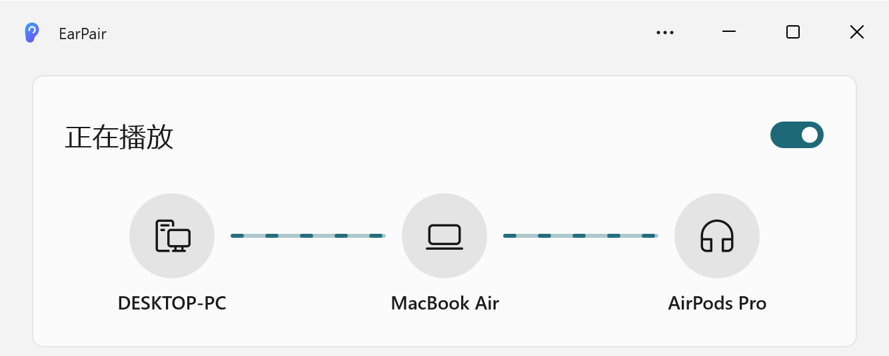

<p align="center">
  
</p>

<h1 align="center">EarPair</h1>

<p align="center">用 Mac 上的 AirPods 听 Windows 电脑的声音。</p>

<p align="center"><a href="README.md">English</a> | <b>简体中文</b></p>

<p align="center">
  <picture>
    <source media="(prefers-color-scheme: dark)" srcset="docs/images/zh-CN/mac-window-dark.png">
    
  </picture>
</p>

AirPods 一直连着 Mac。EarPair 把 Windows 电脑的声音经局域网送到 Mac，和 Mac 自己的声音一起播放。不用来回切换蓝牙，不用多接一根线，声音也不会离开你的局域网：没有账号，不上云，不收集任何数据。

## 功能

- **两台电脑，一副耳机。** 电脑的声音和 Mac 的声音一起，从 Mac 正在用的设备播放：AirPods、扬声器、耳机都行。
- **自动找到 Mac。** Windows 端会列出局域网里的 Mac，点一下就开始，不用输入 IP。
- **音量平衡。** 自动把电脑的声音调到稳定的响度，忽大忽小的声音也听得舒服。
- **电脑不出声。** 发送时把电脑自己的扬声器静音，停止后恢复。
- **不怕 Wi‑Fi 抖动。** 丢包、迟到的包、两台电脑的时钟差，都不会造成爆音或越拖越长的延迟。
- **没声音时不传。** 电脑安静几秒后就停止传送音频，只和 Mac 保持握手，省电也省流量；一有声音马上接着放。
- **分得清是停了还是断了。** 电脑连上或停止发送时，Mac 会弹通知；如果是网络断了，通知会说明，EarPair 也会自动重新连接。
- **不打扰。** Mac 上待在菜单栏，Windows 上待在通知区域，还可以随 Windows 开机启动。
- **Windows 免安装。** 解压就能用，自带 .NET 运行时。

<p align="center">
  <picture>
    <source media="(prefers-color-scheme: dark)" srcset="docs/images/zh-CN/mac-menu-dark.png">
    
  </picture>
  &nbsp;&nbsp;
  <picture>
    <source media="(prefers-color-scheme: dark)" srcset="docs/images/zh-CN/windows-card-dark.png">
    
  </picture>
</p>

## 系统要求

- **Mac**：macOS 14 或以上（macOS 26 起是 Liquid Glass 外观）
- **电脑**：Windows 10（2004 版）或 Windows 11，x64 或 Arm64
- 两台电脑在同一个局域网里

界面有中文和英文，跟随系统语言。

## 开始使用

1. **在 Mac 上**构建并打开 EarPair（需要 Xcode 26 或以上，它要求 macOS 15.6 或以上）：

   ```bash
   git clone https://github.com/milkman-wang/EarPair.git
   cd EarPair/macos && ./scripts/build-app.sh
   open build/EarPair.app
   ```

   EarPair 的窗口会打开，菜单栏里也会出现一个耳朵图标；关掉窗口后 EarPair 继续在菜单栏里运行。macOS 询问是否允许 EarPair 查找本地网络上的设备时，点 **允许**：电脑就是靠这个找到 Mac 的。通知也请允许，这样电脑连上、断开时你都会知道。想长期使用，把 `build/EarPair.app` 移到“应用程序”文件夹。

2. **在电脑上**从 [Releases](https://github.com/milkman-wang/EarPair/releases/latest) 下载 `EarPair-0.2.0-win-x64.zip`（Arm 电脑用 `win-arm64`），解压到任意位置，运行 `EarPair\EarPair.exe`。

3. **点一下你的 Mac**。电脑的声音就从 Mac 播放了，电脑自己的扬声器在你停止之前一直保持静音。

关掉窗口后，EarPair 会留在通知区域继续运行（Windows 11 可能把图标收在 **^** 里）。打开 **开机时启动**，重启后就不用再手动打开。

> [!NOTE]
> EarPair 还没有代码签名。第一次运行时 Windows 可能提示 **Windows 已保护你的电脑**：点 **更多信息 → 仍要运行**。在 Mac 上，每次重新构建都算一个新 App，macOS 会再次询问本地网络权限。

## 使用须知

- **延迟约 0.2–0.3 秒**，包括 AirPods 本身的延迟。听音乐、提示音没问题，但在电脑上看视频会音画不同步。
- **采集的是整台电脑的声音**，还不能单独选 App。按 App 采集在计划中。
- **只在信任的网络里使用。** 声音还没有加密，同一网络里的设备都能往你的 Mac 发声音。
- **发送期间电脑不会自动睡眠。** Mac 不在时会自动暂停发送，回来后自动继续。
- **在 Mac 上调音量。** 电脑上的音量不影响你听到的声音，而且按 Windows 的音量键会取消电脑的静音；把发送关掉再打开即可重新静音。
- **从电脑上删除 EarPair 之前**，先关掉 **开机时启动**，再删除文件夹。

## 常见问题

| 问题 | 怎么办 |
|---|---|
| 电脑上找不到 Mac | 两台电脑连同一个网络（不要用会隔离设备的访客网络），把 Windows 的网络设为 **专用网络**，关掉 VPN。在 Mac 上检查 **系统设置 → 隐私与安全 → 本地网络**。也可以点 **输入地址**，填 Mac 菜单栏面板里显示的 IP。 |
| Mac 菜单栏里没有耳朵图标 | macOS 26 及以上：打开 **系统设置 → 菜单栏**，在 **允许在菜单栏显示** 里打开 EarPair。 |
| Mac 上没有通知 | 在 **系统设置 → 通知 → EarPair** 里打开 **允许通知**。 |
| 重新构建 Mac App 后用不了了 | 照上面的方法，再允许一次 EarPair 访问本地网络。 |
| 电脑的扬声器又响了 | 按了 Windows 的音量键。把发送关掉再打开。 |
| 其他问题 | 在 Windows 上打开 **⋯ → 打开日志文件夹**，看最新的日志。 |

## 命令行版

习惯用终端？命令行版是单个文件，同样在 Releases 页面下载：

```powershell
.\EarPair.Sender-0.2.0-win-x64.exe 192.168.1.20
```

它不会自动找 Mac，也不会静音电脑。加 `--help` 查看全部参数。

## 工作原理

Windows 端采集电脑正在播放的声音，以不压缩的音频经 UDP 发给 Mac。Mac 保持一小段缓冲，抹平丢包和两台电脑的时钟差，再像普通 App 一样播放，由 macOS 把它和其他声音混在一起。两边还会互相告诉对方名字和状态，所以两边都能画出完整的路线。包格式：[音频包](protocol/audio-packet.md)、[控制包](protocol/control-packet.md)。

## 从源码构建

- **Mac**：`macos/scripts/build-app.sh`，需要 Xcode 26 或以上。
- **Windows**：`powershell -ExecutionPolicy Bypass -File windows\build.ps1`，需要 [.NET 10 SDK](https://dotnet.microsoft.com/download/dotnet/10.0)，不需要 Visual Studio；zip 在 `dist\` 里。

测试、工具和目录结构见 [docs/development.zh-CN.md](docs/development.zh-CN.md)。

## 路线图

- 选择要发送的电脑 App
- 配对、加密和代码签名
- 空间音频：让电脑的声音从它屏幕的方向传来
